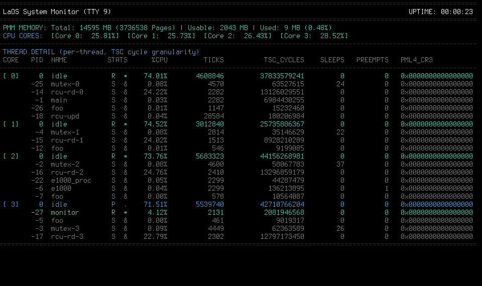

# LaOS: Lyre and Orchestra Symphony

[](https://github.com/erocpil/LaOS/actions/workflows/build.yml?query=branch%3Amain)



本仓库发布 LaOS 的 x86_64 多核抢占式内核快照。不追求 POSIX 兼容，专注 SMP 抢占同步与 selftest 驱动的持续验证。

## Design Highlights

- **声明式任务清单**。`conf/task-base.conf` 与 `conf/test*.conf` 以空格或 tab 分隔的文本声明每个 CPU 应启动的模块，用户程序或内核线程，由内核解析加载，调整任务无需重编译。
- **Linux 风格模块参数**。`MODULE_PARAM(var, type, desc)` 宏生成 `__laos_params` ELF 段，内核在加载模块时匹配 task.conf 的 `key=value` 对，直接写入模块全局变量；驱动入口执行前完成写回。TASK_THREAD 通过 argc/argv 解析实例局部配置。
- **模块双向符号解析**。`.mo` 为独立 ELF，基础组件通过 initrd 交付，测试组件通过独立 Limine 文件集合交付；`ksymtab` 同时支持 kernel 到 module 与 module 到 kernel 两个方向的符号解析。
- **不变量运行期自检**。PMM 初始化末尾调用 `pmm_mark_protected`，reserved 或 ACPI 区若被错误释放即 panic；kheap 释放路径以物理邻接为前提判定块合并。
- **Selftest 框架**。`@test` directive 驱动内置与 `.mo` 模块测试，支持 configure → prepare → start → tick → done → PASSED/FAILED 生命周期。CI 在 x86_64 覆盖基础 selftest、启动载荷多模式、参数、多用户、负向加载、回滚、运行期模块和 LaFS 真设备。

## Features

- **Boot**: Limine BIOS/UEFI 引导，SMP 多核启动。
- **MM**: bitmap first-fit PMM，4 级页表 per-task PML4，带邻接合并的链表 kheap；VMA 虚拟内存区域跟踪，mmap/munmap + 按需分页；页故障恢复——not-present 按需分配，权限违规/越界终止用户进程。
- **Sched**: 内核态可抢占，64 级静态优先级、同级轮转、已入队优先级迁移、睡眠唤醒，以及 mutex 单跳优先级继承（多锁 donation 聚合）。
- **RCU**: 读侧免锁，`gp_seq` / `blocked_tasks` 两阶段推进显式宽限期。
- **Module**: `laos_module_entry(argc, argv)` 内核线程入口，`MODULE_PARAM(int/string/bool)` 编译期声明参数，task.conf 中 `key=value` 加载期写回变量。append-only 注册表支持 FREE/RESERVED/COMMITTED 三态安全回滚。
- **Selftest**: 统一测试子系统——内置测试（registry、VMA、CPIO 等）和 `.mo` 载荷测试（priority/PI、remote enqueue、RCU、IPI、TLB、FPU、调度压力等），串行调度、独立 IPI vector、PASSED/FAILED 门禁集成。
- **Net**: e1000 驱动，12 路 MMIO 硬件计数器 + 软件计数器。
- **TTY**: TTY 0 为控制台，TTY 6-9 为 live monitor（CPU / NET / RCU / PMM），0.5-1 Hz 刷新。
- **User**: crt0 + syscall（mmap / munmap / write / exit / yield）+ CPIO initrd 动态加载用户程序 + `task.conf` 驱动用户态进程。
- **Storage**: virtio-blk 轮询驱动，通过 virtio-pci 访问设备；LaFS 只读文件系统——magic 校验、superblock、inode 链表、间接块索引、目录遍历。提供 QEMU 真设备挂载回归目标。

## Build & Run

### x86_64

```bash
git submodule update --init --recursive
sudo ./script/setup_host_net.sh up    # 创建 tap0
make                                  # 编译,生成 build/LaOS.iso
make run                              # qemu: -smp 4 -device e1000 -netdev tap
sudo ./script/setup_host_net.sh down  # 清理 tap0
```

默认 `make` / `make iso` / `make run` 使用基础 initrd，不交付运行期测试配置或
测试模块。基础配置来自 `conf/task-base.conf`，在归档内为 `/conf/task.conf`。
显式测试使用 `make iso-test` 或 `make test-x86_64`；专项配置通过
`X86_64_TEST_CONF=conf/test-x86_64-*.conf` 选择。测试模式同时加载基础归档与
独立的 Limine `/conf/test.conf`，两份配置和组件不互相回退。
`X86_64_BOOT_MODE=compat` 仅用于旧启动方式；原 `conf/task.conf` 为兼容配置。
完整的启动载荷门禁可通过 `make test-x86_64-boot-payload` 运行；它按顺序检查
配置语法、归档、启动模式、参数、多用户、负向加载及回滚。BSP 在发布 AP 入口前
建立主线程和 idle，上下文检查通过后才继续启动；AP 也在开放本地 IRQ 前完成
并检查自身调度上下文。实现顺序和覆盖边界见
[启动架构](docs/design/boot/boot-arch-zh.md)与
[启动载荷计划](docs/process/boot-payload-refactor-plan.md)。

x86_64 依赖：`gcc`、`nasm`、`xorriso`、`qemu-system-x86_64` 和 Python 3。
macOS 本机脚本要求先切换到 `x86_64` 分支；运行使用 `bash run_x86_64.sh`，自动化验证使用
`bash run_x86_64.sh --test`；脚本采用 Homebrew LLVM/LLD、QEMU TCG 和用户网络，
构建与运行日志保存在 `.local/run-x86_64.*`。

## Documentation

从 [文档入口](docs/index.md) 开始。首次构建参考
[Getting Started](docs/getting-started.md)，当前能力边界以
[Current Limitations](docs/current-limitations.md) 为准。查找测试目标及其
具体方法时，从 [测试入口](docs/testing-guide.md) 开始。

本快照聚焦 x86_64 实现；架构扩展和移植内容不属于此公开快照的维护范围。

## Layout

```
conf/    声明式任务清单
kernel/  内核调度，同步，页表，计数采集
  arch/x86_64/     x86_64 架构代码
module/  可加载模块（e1000、selftest 载荷）
user/    用户态运行时与测试程序
script/  宿主机脚本
docs/    教学文档（book + design + process）
```

## Known Limitations

完整、持续维护的列表见
[docs/current-limitations.md](docs/current-limitations.md)。摘要如下：

- **x86_64 中断栈隔离延后**：致命异常（#DF、NMI、#MC）使用 TSS IST 独立栈；per-CPU 中断栈已分配（8KB），但实际切换与 `switch_to` 的交互尚未处理完，暂继续复用被抢占线程的 kernel stack。
- **PMM 单一全局锁**：无 per-CPU 缓存或并发分区。
- **RCU 仅同步回收**：未提供 `call_rcu` 异步回调。
- **模块符号仅按名查找**：不校验签名版本，旧 `.mo` 载入行为未定义。
- **无 TCP/IP 协议栈**：e1000 仅到 MMIO 收发与计数器层面。
- **存储**：virtio-pci 块设备与 LaFS 只读文件系统，但尚无写入路径。

## License

MIT License. See [LICENSE](LICENSE).
